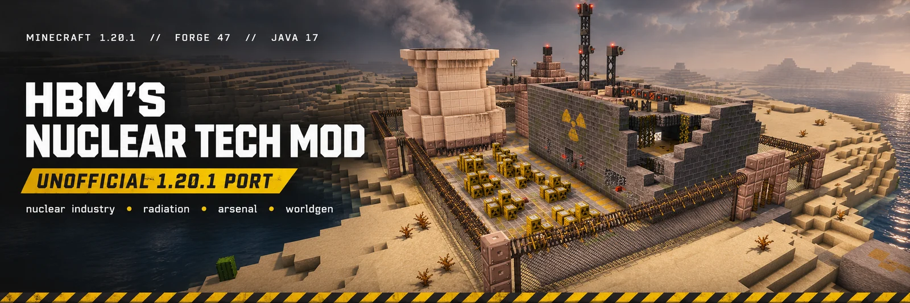
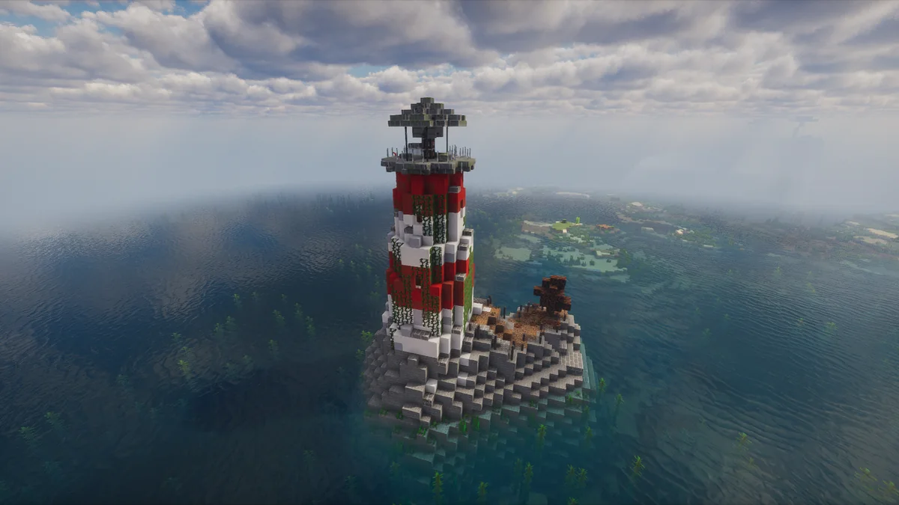
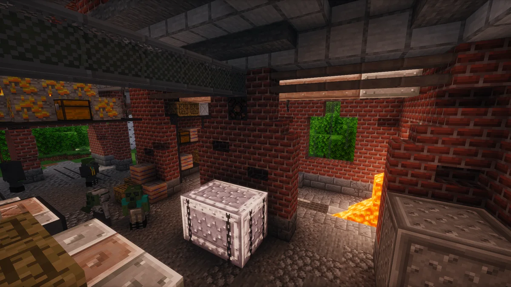
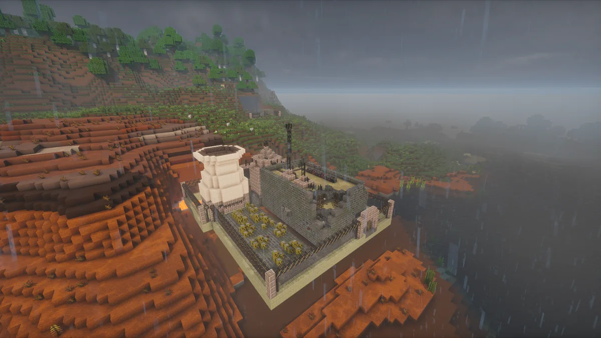

<p align="center">
  <a href="docs/images/readme/full/banner.webp"></a>
</p>

<p align="center">
  <a href="./releases"></a>
  
  
  
  
</p>

<p align="center">
  <a href="README.md">Русский</a> · <b>English</b>
</p>

---

# Welcome to the Facility

In ordinary Minecraft, you build a house, plant potatoes, and try to survive the night.

In **HBM's Nuclear Tech Mod**, you build a factory, master nuclear technology, and eventually discover that the potatoes growing next to your reactor are the least of your problems.

There are reactors, centrifuges, chemical processing, weapons, radiation, and abandoned places that no sane person would enter even for double pay. But you didn't come here to make sensible decisions.

**This is an unofficial port of HBM's Nuclear Tech Mod from Minecraft 1.7.10 to 1.20.1.** The goal is to bring the original's familiar systems, dangers, and personality to a modern version of the game. Development is ongoing.

> [!WARNING]
> **This facility has not passed inspection.** The port launches and generates worlds, but a complete survival playthrough has not yet been verified. Some mechanics may be unfinished, and bugs are to be expected. Back up your worlds. A backup is the only thing guaranteed to survive a failed experiment.

---

## Field Reconnaissance

Three places nobody invited you to visit. The door is open, though.

<table>
<tr>
<td width="33%" valign="top">
  <a href="docs/images/readme/full/lighthouse.webp"></a><br>
  <sub><b>The lighthouse.</b> Standing alone out at sea. Judging by the ivy, the keeper hasn't reported for duty in quite some time. You'll have to find out why yourself.</sub>
</td>
<td width="33%" valign="top">
  <a href="docs/images/readme/full/interior.webp"></a><br>
  <sub><b>The factory.</b> Supplies are still here, the lava is still flowing, and the shift is wandering the floor. Apparently, being dead isn't grounds for dismissal.</sub>
</td>
<td width="33%" valign="top">
  <a href="docs/images/readme/full/badlands.webp"></a><br>
  <sub><b>The ruined nuclear power plant.</b> Rain washes the dust off the wreckage. As usual, dealing with the aftermath has been left to whoever shows up next.</sub>
</td>
</tr>
</table>

*Click an image to see the full-size screenshot.*

## Recommended Mods

The mod runs without them. With them, you spend your time building production lines instead of trying to remember a recipe and figure out where you are.

| Mod | Why | Who |
| :--- | :--- | :--- |
| **JEI** (Just Enough Items) | every recipe and use in one window | everyone |
| **JourneyMap** | world map and waypoints: structures get found, bases don't get lost | everyone |
| **Oculus** + **Embeddium** | shaders and faster rendering; install as a pair | if your PC can take it |

All of these are client-side Forge mods for 1.20.1, dropped into `.minecraft/mods` as usual; the server doesn't need them. Shader packs go separately, into `shaderpacks`.

*Tested with JEI 15.20.0.127, JourneyMap 6.0.0, Oculus 1.8.0, Embeddium 0.3.31.*

## What You'll Be Doing Here

### ☢ Radiation. You Can't See It. It Can See You.

Your Geiger counter starts clicking. Your dosimeter shows numbers you'd rather not know. Radiation passes through barriers, builds up in your body, and can contaminate the ground.

A concrete wall holds the field back, but it doesn't save you: the field is three-dimensional and goes around it, over the top and underneath. A sealed shell works better — still not a free pass. Protective gear, proper measurements, and caution will do more for you than bravery.

*If the counter suddenly goes quiet, don't celebrate just yet. Check the battery first.*

### ⚙ Industry. It All Started with One Ingot.

Ore needs processing. Materials need separating. Chemicals need making. Then come assembly lines, power generation, and logistics. Centrifuges and production lines won't run on good intentions; every step up demands more resources and infrastructure.

Eventually, you'll have an industrial empire of your own. And a remarkably long list of things that can go wrong with it.

### 🔫 The Arsenal. For When Negotiations Break Down.

The **Sedna** system brings **12 calibers** and **more than 80 types of ammunition**. Powered armor comes with **VATS**, thermal vision, and a jetpack. Hazmat suits let you work in places where regular clothing is a poor long-term investment.

There are warheads, too — from relatively simple ones to those you'll have to assemble yourself.

*The surrounding countryside will usually know your assembly was successful before you can take a screenshot.*

### 🌫 A World Abandoned Without Explanation

**39 generated structures**: bunkers, military silos, laboratories, crashed ships, towers, installations in the badlands, and wreckage. On the surface, underground, and beneath the oceans.

You won't always know who built these places, why they left, or what's still inside. You could just walk past.

But then why did you bring so much ammunition?

---

## The Numbers, Straight from the Report

**755** block states · **2,677** item models · **1,347** recipes · **39** structures.

These figures describe the content that has been ported — **not a guarantee that every progression chain is fully playable**. Development continues.

## Installation

**Requirements:**
- Minecraft **1.20.1**
- **Forge 47.4.10** or newer for Minecraft 1.20.1
- **Java 17**

1. Install Forge for Minecraft 1.20.1.
2. Download the current `hbm-1.20.1-*.jar` from [Releases](https://github.com/Jackasm/HbmNuclearTech-1.20.1/releases).
3. Place the JAR in your `.minecraft/mods` folder.
4. Launch Minecraft using your Forge profile.

**A note from Asset Protection:** Back up any world you care about before loading it. We only issue a second warning to people who survived the first.

## For Developers

You'll need **JDK 17**. To build from source:

```bash
git clone https://github.com/Jackasm/HbmNuclearTech-1.20.1.git
cd HbmNuclearTech-1.20.1
./gradlew build
```

On Windows, use `gradlew.bat build`. The resulting JAR will be in `build/libs`. If necessary, regenerate data with `./gradlew runData`.

## Credits

The original **HBM's Nuclear Tech Mod** was created by **Bobcat**, with contributions from **Alcater**, **Drillgon200**, and many others. The original models, textures, sounds, and design are their work.

The unofficial port to Minecraft 1.20.1 is developed by **Jackasm**.

## License

The original mod is distributed under **GPL-3.0**. This port retains the same license; see [LICENSE](LICENSE) for details.

This is an **unofficial project** and is neither affiliated with nor endorsed by the original mod's creators. For the original HBM's Nuclear Tech Mod experience, play the Minecraft 1.7.10 version.

---

> **Safety Department Reminder**
>
> Just because the facility is quiet doesn't mean everything is fine.
>
> **Have a safe shift.**
