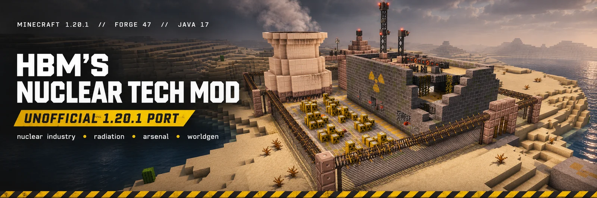
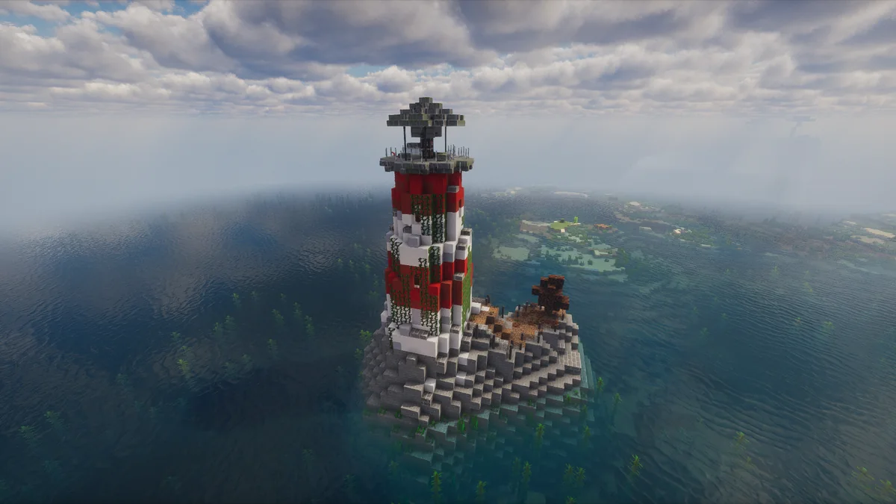
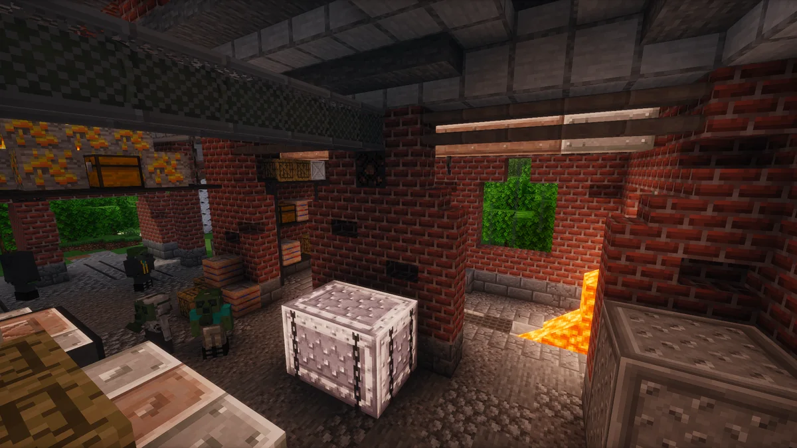
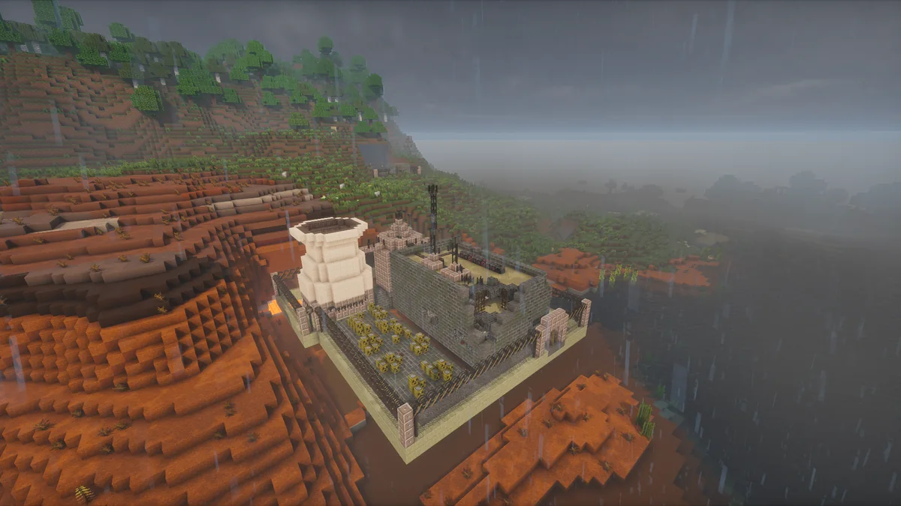

<p align="center">
  <a href="docs/images/readme/full/banner.webp"></a>
</p>

<p align="center">
  <a href="./releases"></a>
  
  
  
  
</p>

<p align="center">
  <b>Русский</b> · <a href="README.en.md">English</a>
</p>

---

# Добро пожаловать на объект

В обычном Minecraft вы строите дом, сажаете картошку и стараетесь дожить до утра.

В **HBM's Nuclear Tech Mod** вы строите завод, осваиваете ядерные технологии и однажды обнаруживаете, что картошка рядом с реактором — уже не главная проблема.

Здесь есть реакторы, центрифуги, химическое производство, оружие, радиация и заброшенные места, в которые здравомыслящий человек не полез бы даже за двойную оплату. Но вы ведь пришли не за здравым смыслом.

**Это неофициальный порт HBM's Nuclear Tech Mod с Minecraft 1.7.10 на 1.20.1.** Цель — вернуть знакомые системы, опасности и характер оригинала на современную версию игры. Работа ещё идёт.

> [!WARNING]
> **Объект не принят комиссией.** Порт запускается и генерирует мир, но полное прохождение в режиме выживания пока не проверено. Возможны недоработанные механики и ошибки. Делайте резервные копии миров. Архивная копия — единственное, что гарантированно переживёт неудачный эксперимент.

---

## Из материалов разведки

Три места, куда никто не приглашал. Впрочем, дверь уже открыта.

<table>
<tr>
<td width="33%" valign="top">
  <a href="docs/images/readme/full/lighthouse.webp"></a><br>
  <sub><b>Маяк.</b> Стоит один посреди воды. Судя по плющу, смотритель давно не выходил на смену. Выяснять причину придётся лично.</sub>
</td>
<td width="33%" valign="top">
  <a href="docs/images/readme/full/interior.webp"></a><br>
  <sub><b>Фабрика.</b> Запасы на месте, лава течёт, смена бродит по цеху. Покойников здесь, похоже, увольнять не принято.</sub>
</td>
<td width="33%" valign="top">
  <a href="docs/images/readme/full/badlands.webp"></a><br>
  <sub><b>Разрушенная АЭС.</b> Дождь смывает пыль с руин. С последствиями аварии, как обычно, придётся разбираться посетителям.</sub>
</td>
</tr>
</table>

*Нажмите на изображение, чтобы открыть полный кадр.*

## Рекомендуемые моды

Сам мод работает и без них. Но с ними вы тратите время на производство, а не на попытки вспомнить рецепт и понять, где вы находитесь.

| Мод | Зачем | Кому |
| :--- | :--- | :--- |
| **JEI** (Just Enough Items) | все рецепты и применения предметов в одном окне | всем |
| **JourneyMap** | карта мира и метки: структуры находятся, база не теряется | всем |
| **Oculus** + **Embeddium** | шейдеры и быстрый рендер; ставятся парой | если ПК позволяет |

Всё это — клиентские Forge-моды для 1.20.1, ставятся в `.minecraft/mods` как обычно; на сервер их не нужно. Шейдерпаки кладутся отдельно, в `shaderpacks`.

*Проверено с JEI 15.20.0.127, JourneyMap 6.0.0, Oculus 1.8.0, Embeddium 0.3.31.*

## Чем здесь занимаются

### ☢ Радиация. Её не видно, но она вас заметила

Счётчик Гейгера начинает трещать. Дозиметр показывает цифры, которых хотелось бы не знать. Излучение проходит через преграды, накапливается в организме и может загрязнять местность.

Бетонная стена держит фон, но не спасает: поле трёхмерное и обходит её сверху и снизу. Замкнутая оболочка работает лучше — но и она не индульгенция. Защита, измерения и осторожность здесь полезнее героизма.

*Если прибор вдруг замолчал, не спешите радоваться. Для начала проверьте батарейку.*

### ⚙ Промышленность. Началось всё с одного слитка

Руду нужно переработать. Материалы — разделить. Химию — запустить. Затем подключить сборку, энергию и логистику. Центрифуги и производственные линии не работают на добром слове: каждой новой ступени нужны ресурсы и инфраструктура.

В какой-то момент у вас будет собственная промышленная держава. И очень длинный список того, что в ней может пойти не так.

### 🔫 Арсенал. На случай неудачных переговоров

Система **Sedna**: **12 калибров** и **более 80 типов боеприпасов**. Силовая броня с **VATS**, тепловизором и джетпаком. Химзащита для мест, где обычная одежда — плохая инвестиция.

Есть и боеголовки: от сравнительно простых вариантов до тех, что предстоит собирать самому.

*Окрестности обычно узнают об успешной сборке раньше, чем вы успеваете сделать скриншот.*

### 🌫 Мир, оставленный без объяснений

**39 генерируемых структур**: бункеры, военные шахты, лаборатории, разбившиеся корабли, вышки, сооружения в пустошах и обломки. На поверхности, под землёй и в океанах.

Здесь не всегда понятно, кто построил объект, почему его бросили и что осталось внутри. Можно пройти мимо.

Но тогда зачем вы взяли с собой столько патронов?

---

## Сухие цифры из отчёта

**755** состояний блоков · **2 677** моделей предметов · **1 347** рецептов · **39** структур.

Это объём перенесённого содержимого, **не обещание полной готовности всех игровых цепочек**. Порт продолжает развиваться.

## Установка

**Понадобятся:**
- Minecraft **1.20.1**
- **Forge 47.4.10** или новее для Minecraft 1.20.1
- **Java 17**

1. Установите Forge для Minecraft 1.20.1.
2. Скачайте актуальный файл `hbm-1.20.1-*.jar` со страницы [Releases](https://github.com/Jackasm/HbmNuclearTech-1.20.1/releases).
3. Поместите JAR в папку `.minecraft/mods`.
4. Запустите Minecraft с профилем Forge.

**Совет отдела сохранности имущества:** перед запуском на любимом мире сделайте его резервную копию. Дважды предупреждать будем только тех, кто пережил первый раз.

## Для разработчиков

Нужен **JDK 17**. Сборка из исходников:

```bash
git clone https://github.com/Jackasm/HbmNuclearTech-1.20.1.git
cd HbmNuclearTech-1.20.1
./gradlew build
```

Для Windows используйте `gradlew.bat build`. Результат находится в `build/libs`. При необходимости данные можно перегенерировать командой `./gradlew runData`.

## Авторы и благодарности

Оригинальный **HBM's Nuclear Tech Mod** создал **Bobcat** при участии **Alcater**, **Drillgon200** и многих других контрибьюторов. Оригинальные модели, текстуры, звуки и дизайн — результат их работы.

Неофициальный порт для Minecraft 1.20.1 разрабатывает **Jackasm**.

## Лицензия

Оригинальный мод распространяется под **GPL-3.0**. Порт сохраняет ту же лицензию; подробности — в [LICENSE](LICENSE).

Это **неофициальный проект**, не связанный с авторами оригинального мода и не одобренный ими. За оригинальным опытом HBM's Nuclear Tech Mod — на Minecraft 1.7.10.

---

> **Напоминание службы безопасности**
>
> Если на объекте тихо, это ещё не значит, что всё в порядке.
>
> **Удачной смены.**
